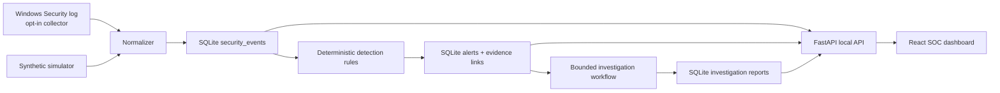

# SentinelAI architecture

The backend binds to loopback by default when launched using the README commands. Raw event text is kept local; the investigation workflow uses normalized alert fields and linked event metadata, never executes commands or changes endpoint settings. Detection severity is deterministic and is stored separately from investigation risk.

## Event lifecycle

1. The simulator or optional Windows Event Log reader submits normalized events.
2. Ingestion normalizes timestamps to UTC and uses stable event keys to avoid duplicate Windows records.
3. Detection rules correlate failed logons by account and source over configured windows. Alerts link back to the supporting event rows.
4. An analyst starts an investigation from an alert. The local workflow builds a structured report with evidence, uncertainty, potential impact, and recommendations.
5. Dashboard pages read the API and refresh on a short polling interval.

The Windows collector reads Security event IDs 4624 and 4625 only. Windows event field layouts vary by provider and version; username/source IP extraction is best-effort and unparsed values stay unknown. Administrative access may be needed to read the Security channel.
